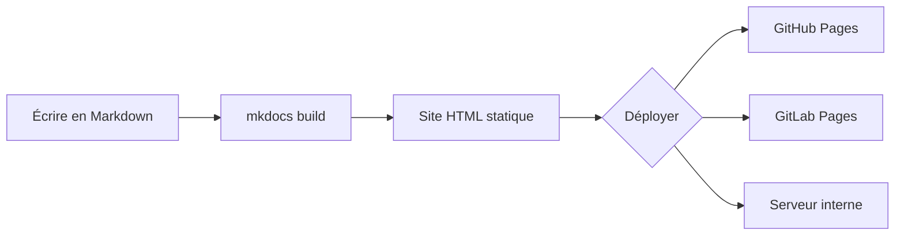

# Cheatsheet MKDOCS


!!! note "Information importante"
    Le contenu de l'admonition supporte **tout le Markdown** :
    listes, code, liens, etc.

!!! tip "Astuce"
    Utilisez `mkdocs serve --dirty` pour accélérer le rechargement
    sur les gros projets (seules les pages modifiées sont regénérées).

!!! warning "Attention"
    Ne commitez jamais de secrets dans votre documentation.

!!! danger "Danger"
    Supprimer le dossier `site/` en production efface la documentation
    déployée.


???+ example "Cliquez pour voir l'exemple"
    Contenu masqué par défaut. Utile pour les longues sorties
    de commandes ou les configurations complètes.

=== "Ubuntu/Debian"

    ```bash
    sudo apt update && sudo apt install -y python3-pip
    pip install mkdocs-material
    ```

=== "Rocky/RHEL"

    ```bash
    sudo dnf install -y python3-pip
    pip install mkdocs-material
    ```

=== "macOS"

```bash
brew install python3
pip3 install mkdocs-material
```


MkDocs génère des sites statiques[^1] à partir de Markdown.

[^1]: Un site statique est composé uniquement de fichiers HTML, CSS
    et JavaScript, sans base de données ni serveur applicatif.


<div class="grid cards" markdown>

-   :material-clock-fast: **Mise en place en 5 minutes**

    ---

    Installez `mkdocs-material` avec `pip` et démarrez en quelques minutes.

    [:octicons-arrow-right-24: Commencer](#)

-   :fontawesome-brands-markdown: **C'est juste du Markdown**

    ---

    Concentrez-vous sur le contenu, Material génère le site.

    [:octicons-arrow-right-24: Référence](#)

</div>

:material-account-circle: Profil utilisateur
:fontawesome-brands-docker: Conteneur Docker
:octicons-terminal-24: Terminal
:smile: Emoji sourire

Le HTML est le langage de base du web. Le W3C en maintient la spécification.

Le principe du CI/CD est de mettre en place

- ==Texte surligné== avec `pymdownx.mark`
- ^^Texte souligné (insertion)^^ avec `pymdownx.caret`
- ~~Texte barré (suppression)~~ avec `pymdownx.tilde`
- H~2~O (subscript) et A^T^A (superscript)
- Raccourci clavier : ++ctrl+alt+del++
- Suivi : {--texte supprimé--} et {++texte ajouté++}

[Commencer le tutoriel](#){ .md-button }
[Télécharger :fontawesome-solid-download:](#){ .md-button .md-button--primary }