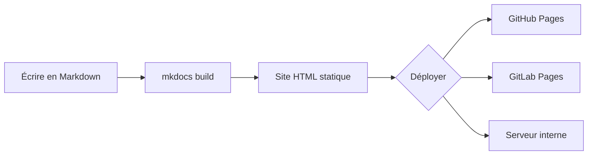
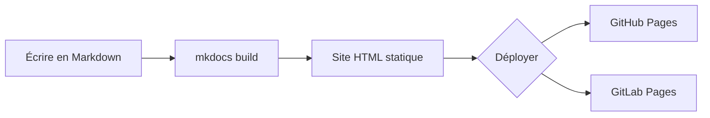

# Cheatsheet MKDOCS

## Les commandes

* `py -m mkdocs new [dir-name]` - Create a new project.
* `py -m mkdocs serve` - Start the live-reloading docs server.
* `py -m mkdocs build` - Build the documentation site.
* `py -m mkdocs -h` - Print help message and exit.

## Configuration 

<details>
<summary>Fichier de configuration</summary>

```yml title="mkdocs.yml"
# -- Métadonnées du site --
site_name: Documentation
site_url: https://mon-equipe.github.io/docs/
site_description: Documentation technique
site_author: Équipe AFPA

# -- Thème Material --
theme:
name: material
language: fr                    # Interface en français
palette:
    - scheme: default             # Mode clair
    primary: indigo             # À adapter à votre charte graphique
    accent: indigo              # À adapter à votre charte graphique
    toggle:
        icon: material/brightness-7
        name: Passer au mode sombre
    - scheme: slate               # Mode sombre
    primary: indigo             # À adapter à votre charte graphique
    accent: indigo              # À adapter à votre charte graphique
    toggle:
        icon: material/brightness-4
        name: Passer au mode clair
features:
    - navigation.instant          # Navigation instantanée (fetch + replace)
    - navigation.instant.prefetch # Préchargement des pages au survol
    - navigation.tracking         # URL reflète la section visible
    - navigation.tabs             # Onglets de navigation principaux
    - navigation.sections         # Sections dans la sidebar
    - navigation.top              # Bouton retour en haut
    - navigation.indexes          # Pages d'index de section
    - search.suggest              # Suggestions de recherche
    - search.highlight            # Surlignage des résultats
    - content.code.copy           # Bouton copier sur les blocs de code
    - content.code.annotate       # Annotations dans le code
    - content.tabs.link           # Onglets liés entre sections
    - content.tooltips            # Tooltips améliorés sur les liens
    - toc.follow                  # Table des matières suit le scroll

# -- Plugins --
plugins:
- search:
    lang: fr                    # Recherche en français
- tags                          # Système de tags

# -- Extensions Markdown --
markdown_extensions:
- admonition                              # Encadrés (note, tip, warning...)
- pymdownx.details                        # Encadrés dépliables
- pymdownx.superfences:                   # Blocs de code avancés
    custom_fences:
        - name: mermaid                     # Diagrammes Mermaid
        class: mermaid
        format: !!python/name:pymdownx.superfences.fence_code_format
- pymdownx.tabbed:                        # Onglets de contenu
    alternate_style: true
- pymdownx.highlight:                     # Coloration syntaxique
    anchor_linenums: true
    line_spans: __span
    pygments_lang_class: true
- pymdownx.inlinehilite                   # Code inline coloré
- pymdownx.snippets                       # Inclusion de fichiers
- pymdownx.emoji:                         # Emojis et icônes
    emoji_index: !!python/name:material.extensions.emoji.twemoji
    emoji_generator: !!python/name:material.extensions.emoji.to_svg
- attr_list                               # Attributs HTML sur éléments
- md_in_html                              # Markdown dans le HTML
- tables                                  # Tableaux
- footnotes                               # Notes de bas de page
- pymdownx.critic                         # Suivi des modifications
- pymdownx.caret                          # Superscript et insertion
- pymdownx.keys                           # Raccourcis clavier
- pymdownx.mark                           # Surlignage de texte
- pymdownx.tilde                          # Subscript et barré
- toc:                                    # Table des matières
    permalink: true
- pymdownx.tasklist:                      # Listes de tâches
    custom_checkbox: true
- def_list                                # Listes de définitions
- abbr                                    # Abréviations

# -- Navigation --
nav:
- Accueil: index.md
- Guide:
    - Installation: guide/installation.md
    - Configuration: guide/configuration.md
    - Déploiement: guide/deploiement.md
- Référence:
    - API: reference/api.md

# -- Pied de page et liens sociaux --
extra:
social:
    - icon: fontawesome/brands/github
    link: https://github.com/mon-equipe
    - icon: fontawesome/brands/gitlab
    link: https://gitlab.com/mon-equipe
```
</details>

Décomposons les sections clés de cette configuration :

**Métadonnées du site** : les quatre premières lignes (site_name, site_url, etc.) définissent l'identité du site. Le site_url est important : il sert à générer les liens canoniques et le sitemap. Définissez-le même en développement.

**Thème et palette**: la section theme active Material et configure le basculement clair/sombre. Chaque scheme définit ses couleurs primary (barre de navigation, liens) et accent (éléments interactifs au survol). Changez indigo par la couleur de votre charte graphique.

**Features** : chaque ligne active un comportement précis. navigation.instant rend la navigation fluide (les pages se chargent sans refresh complet). content.code.copy ajoute un bouton "copier" sur tous les blocs de code. search.suggest propose des suggestions pendant la frappe dans la barre de recherche. Désactivez une feature en la commentant : le site fonctionnera toujours, avec un comportement plus basique.

**Extensions Markdown** : c'est la liste des extensions qui enrichissent la syntaxe Markdown. Sans elles, vous n'avez que le Markdown de base (titres, listes, gras). Chaque extension ajoute une fonctionnalité : admonition pour les encadrés colorés, pymdownx.tabbed pour les onglets, pymdownx.superfences pour Mermaid, etc. L'ordre n'a pas d'importance.

**Navigation (nav)** : cette section contrôle l'ordre et la hiérarchie des pages dans le menu latéral. Sans elle, MkDocs génère la navigation automatiquement à partir de l'arborescence des fichiers (ce qui fonctionne bien pour les petits sites, mais devient aléatoire sur les gros projets).

## Organiser le contenu

Dans MkDocs, chaque fichier Markdown du dossier `docs/` devient une page du site. L'arborescence des fichiers détermine la structure de la navigation : un dossier `guide/` crée une section "Guide" dans le menu, et chaque fichier `.md` à l'intérieur devient un lien dans cette section.

Voici un exemple d'organisation typique pour une documentation :

```graphique
docs/
├── index.md                    # Page d'accueil
├── guide/
│   ├── installation.md         # Guide d'installation
│   ├── configuration.md        # Guide de configuration
│   └── deploiement.md          # Guide de déploiement
├── reference/
│   ├── api.md                  # Référence API
│   └── cli.md                  # Référence CLI
├── runbooks/
│   ├── incident-base.md        # Procédure incident base de données
│   └── rollback.md             # Procédure de rollback
└── assets/
    └── images/                 # Images et schémas
```
La section `nav` de `mkdocs.yml` permet de contrôler **explicitement** l'ordre et la hiérarchie des pages. C'est recommandé pour tout projet ayant plus d'une dizaine de pages : sans `nav`, MkDocs trie les fichiers par ordre alphabétique, ce qui produit souvent un menu incohérent ("API" avant "Installation", par exemple). Avec `nav`, vous décidez précisément ce que le lecteur voit et dans quel ordre.

## Rédiger du contenu enrichi

Material for MkDocs étend considérablement les possibilités du Markdown standard. Les fonctionnalités sont regroupées par niveau d'utilité :

  * **Essentiel** : admonitions, onglets, blocs de code avec copie, Mermaid
  * **Très utile** : annotations de code, snippets, listes de tâches, tooltips/glossaire, footnotes
  * **Bonus** : grilles de cartes, formatage avancé (Critic, surlignage, touches clavier), boutons, images clair/sombre, lightbox

Commencez par les fonctionnalités essentielles, puis enrichissez au fil des besoins.

### Admonitions (encadrés)
Les **admonitions** permettent de mettre en valeur des informations importantes. Elles sont activées par l'extension `admonition`.

```text linenums="0"
!!! note "Information importante"
    Le contenu de l'admonition supporte **tout le Markdown** :
    listes, code, liens, etc.

!!! tip "Astuce"
    Utilisez `mkdocs serve --dirty` pour accélérer le rechargement
    sur les gros projets (seules les pages modifiées sont regénérées).

!!! warning "Attention"
    Ne commitez jamais de secrets dans votre documentation.

!!! danger "Danger"
    Supprimer le dossier `site/` en production efface la documentation
    déployée.
```
!!! note "Information importante"
    Le contenu de l'admonition supporte **tout le Markdown** :
    listes, code, liens, etc.

!!! tip "Astuce"
    Utilisez `mkdocs serve --dirty` pour accélérer le rechargement
    sur les gros projets (seules les pages modifiées sont regénérées).

!!! warning "Attention"
    Ne commitez jamais de secrets dans votre documentation.

!!! danger "Danger"
    Supprimer le dossier `site/` en production efface la documentation
    déployée.

Pour créer un encadré dépliable (fermé par défaut), on remplace !!! par ??? (nécessite l'extension pymdownx.details) :

```text linenums="0"
??? example "Cliquez pour voir l'exemple"
    Contenu masqué par défaut. Utile pour les longues sorties
    de commandes ou les configurations complètes.
```
??? example "Cliquez pour voir l'exemple"
    Contenu masqué par défaut. Utile pour les longues sorties
    de commandes ou les configurations complètes.

Ajouter un + après ??? rend l'encadré dépliable mais ouvert par défaut :

```text linenums="0"
???+ tip "Astuce (ouverte par défaut)"
    L'utilisateur peut replier cet encadré s'il le souhaite.
```
???+ tip "Astuce (ouverte par défaut)"
    L'utilisateur peut replier cet encadré s'il le souhaite.

On peut aussi rendre un encadré inline (flottant à droite ou à gauche du texte) avec le modificateur inline :

```text linenums="0"
!!! info inline end "Rappel"
    Cet encadré flotte à droite du paragraphe suivant.
```

Les types disponibles sont : `note`, `abstract`, `info`, `tip`, `success`, `question`, `warning`, `failure`, `danger`, `bug`, `example`, `quote`.

### Onglets de contenu

Les **onglets** permettent de présenter des variantes d'une même procédure (distributions Linux, langages, outils). Ils sont activés par l'extension `pymdownx.tabbed`.

```text linenums="0"
=== "Ubuntu/Debian"

    ```bash
    sudo apt update && sudo apt install -y python3-pip
    pip install mkdocs-material
    ```

=== "Rocky/RHEL"

    ```bash
    sudo dnf install -y python3-pip
    pip install mkdocs-material
    ```

=== "macOS"

    ```bash
    brew install python3
    pip3 install mkdocs-material
    ```
```
Resulat : 
=== "Ubuntu/Debian"

    ```bash
    sudo apt update && sudo apt install -y python3-pip
    pip install mkdocs-material
    ```

=== "Rocky/RHEL"

    ```bash
    sudo dnf install -y python3-pip
    pip install mkdocs-material
    ```

=== "macOS"

    ```bash
    brew install python3
    pip3 install mkdocs-material
    ```
Avec l'option `content.tabs.link` activée dans les features du thème, un clic sur un onglet synchronise tous les onglets de la page qui portent le même label.

### Blocs de code avancés

Material ajoute des fonctionnalités puissantes aux blocs de code standard :

Titre, numéros de lignes et bouton copier :

??? tips "Ajouter dans les features de configuration du thème"
    ```yml
    theme:
        name: material
        features:
            - content.code.copy # Bouton copier sur les blocs de code
            - content.code.annotate # Annotations dans le code
            - content.code.select # Sélection du code
    ```

````markdown linenums="0"
```python title="hello.py" linenums="1"
def saluer(nom: str) -> str:
    """Retourne un message de bienvenue."""
    return f"Bonjour {nom} !"

print(saluer("DevOps"))
```
````
**Annotations** dans le code (nécessite `content.code.annotate` dans les features) :

````markdown
```yaml title="mkdocs.yml"
theme:
  name: material # (1)!
  features:
    - navigation.instant # (2)!
```

1. Le thème Material est le plus populaire pour MkDocs
2. Active la navigation sans rechargement de page
````
Les annotations apparaissent comme des **icônes cliquables** dans le code. Au clic, une bulle affiche l'explication. Cela permet d'expliquer chaque ligne sans surcharger le bloc de code.

```yaml title="mkdocs.yml"
theme:
  name: material # (1)!
  features:
    - navigation.instant # (2)!
```

1. Le thème Material est le plus populaire pour MkDocs
2. Active la navigation sans rechargement de page

**Mise en surbrillance de lignes spécifiques :**

=== "Ligne"

    ````markdown
    ```py hl_lines="2 5"
    def bubble_sort(items):
        for i in range(len(items)):
            for j in range(len(items) - 1 - i):
                if items[j] > items[j + 1]:
                    items[j], items[j + 1] = items[j + 1], items[j]
    ```
    ````

    ```py hl_lines="2 5"
    def bubble_sort(items):
        for i in range(len(items)):
            for j in range(len(items) - 1 - i):
                if items[j] > items[j + 1]:
                    items[j], items[j + 1] = items[j + 1], items[j]
    ```

=== "Multi ligne"

    ````markdown
    ```py hl_lines="2-4"
    def bubble_sort(items):
        for i in range(len(items)):
            for j in range(len(items) - 1 - i):
                if items[j] > items[j + 1]:
                    items[j], items[j + 1] = items[j + 1], items[j]
    ```
    ````

    ```py hl_lines="2-4"
    def bubble_sort(items):
        for i in range(len(items)):
            for j in range(len(items) - 1 - i):
                if items[j] > items[j + 1]:
                    items[j], items[j + 1] = items[j + 1], items[j]
    ```
=== "Combinaisons"

    ````markdown
    ```py hl_lines="1 3-5"
    def bubble_sort(items):
        for i in range(len(items)):
            for j in range(len(items) - 1 - i):
                if items[j] > items[j + 1]:
                    items[j], items[j + 1] = items[j + 1], items[j]
    ```
    ````

    ```py hl_lines="1 3-5"
    def bubble_sort(items):
        for i in range(len(items)):
            for j in range(len(items) - 1 - i):
                if items[j] > items[j + 1]:
                    items[j], items[j + 1] = items[j + 1], items[j]
    ```
### Diagrammes Mermaid

Material rend [Mermaid](https://mermaid.js.org/) simple à activer via l'extension `pymdownx.superfences` et une configuration `custom_fences`. Mermaid génère des diagrammes à partir de texte, idéal pour documenter des architectures et des flux.

````markdown

````



### Listes de tâches et notes de bas de page

``` linenums="0"

- [x] Installer MkDocs
- [x] Configurer le thème Material
- [ ] Rédiger la documentation
- [ ] Déployer sur GitHub Pages
```

- [x] Installer MkDocs
- [x] Configurer le thème Material
- [ ] Rédiger la documentation
- [ ] Déployer sur GitHub Pages

Les notes de bas de page permettent d'ajouter des références sans couper le fil de lecture :

``` linenums="0"
MkDocs génère des sites statiques[^1] à partir de Markdown.

[^1]: Un site statique est composé uniquement de fichiers HTML, CSS
    et JavaScript, sans base de données ni serveur applicatif.
```


MkDocs génère des sites statiques[^1] à partir de Markdown.

[^1]: Un site statique est composé uniquement de fichiers HTML, CSS
    et JavaScript, sans base de données ni serveur applicatif.

