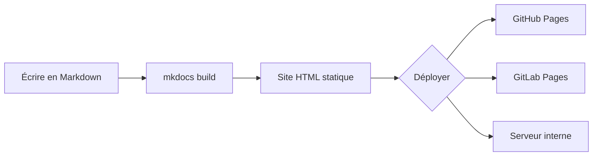

# MkDocs : créer un site de documentation DevOps


[**MkDocs**](https://www.mkdocs.org/) transforme de simples fichiers Markdown en un **site de documentation professionnel**, avec recherche intégrée, navigation et thème responsive. Combiné au thème [**Material for MkDocs**](https://squidfunk.github.io/mkdocs-material/) (version 9.7), on obtient un outil complet pour toute équipe [DevOps](/docs/devops/fondamentaux/) : admonitions, onglets, annotations de code, diagrammes [Mermaid](https://mermaid.js.org/), mode sombre, et déploiement en une commande. Ce guide couvre l'installation, la configuration avancée, la personnalisation et le déploiement CI/CD. Prérequis : **[Python](/docs/developper/programmation/python/) 3.9+** et **pip** installés.

## Qu'est-ce que MkDocs ?

Section intitulée « Qu'est-ce que MkDocs ? »

[**MkDocs**](https://www.mkdocs.org/) est un **générateur de site statique** (SSG) conçu spécifiquement pour la documentation technique. Contrairement à un CMS comme WordPress, MkDocs prend des fichiers Markdown et un fichier de configuration [YAML](/docs/developper/autres-langages/yaml/), puis génère un site HTML complet, prêt à être hébergé n'importe où.

On peut le comparer à un **compilateur pour la documentation** : on écrit du texte brut (Markdown), MkDocs le transforme en pages web interactives avec navigation, recherche et mise en forme.

| Caractéristique | MkDocs | Wiki classique | Google Docs |
| --- | --- | --- | --- |
| Format source | Markdown (fichiers texte) | Interface web | Interface web |
| Versioning | [Git](/docs/developper/version/git/) natif | Intégré (limité) | Historique Google |
| Collaboration | Pull requests, revues | Édition directe | Édition simultanée |
| Hébergement | Statique (gratuit) | Serveur nécessaire | Cloud Google |
| Personnalisation | Thèmes + extensions | Limitée | Très limitée |
| Hors-ligne | Oui (fichiers locaux) | Non | Non |

[**Material for MkDocs**](https://squidfunk.github.io/mkdocs-material/) (version 9.7.7) est le thème le plus populaire. Depuis la version **9.7.0 (11 novembre 2025)**, toutes les fonctionnalités anciennement réservées aux sponsors Insiders sont disponibles gratuitement pour tout le monde.

## Prérequis

Section intitulée « Prérequis »

Avant de commencer, vérifiez que votre machine dispose de :

* **Python 3.9 ou supérieur** : MkDocs est un outil Python
* **pip** : le gestionnaire de paquets Python (inclus avec Python)
* **Git** : pour le versioning et le déploiement (recommandé)

Fenêtre de terminal

```
python3 --version
pip --version
```

**Vérification :** ces commandes doivent afficher les versions installées. Si `pip` n'est pas trouvé, installez-le avec `python3 -m ensurepip --upgrade`.

## Installation

Section intitulée « Installation »

MkDocs s'installe en une seule commande. On recommande d'installer directement **mkdocs-material**, qui inclut MkDocs et toutes les dépendances nécessaires.

* pip (recommandé)
* pipx (isolé)
* Docker

Fenêtre de terminal

```
pip install mkdocs-material
```

Cette commande installe **MkDocs 1.6.1**, **Material 9.7.7**, [**Pygments**](https://pygments.org/) (coloration syntaxique), [**Python Markdown Extensions**](https://facelessuser.github.io/pymdown-extensions/) et toutes les dépendances. Relevé le 20 septembre 2026 sur **Debian 13** avec **Python 3.13.5** : `mkdocs==1.6.1`, `mkdocs-material==9.7.7`, `Markdown==3.10.3`, `Pygments==2.21.0`, `pymdown-extensions==12.0.1`.

**Vérification :** confirmez l'installation avec :

Fenêtre de terminal

```
mkdocs --version
```

Le résultat attendu est :

```
mkdocs, version 1.6.1 from [...] (Python 3.12)
```

## Créer un projet

Section intitulée « Créer un projet »

1. **Initialisez le projet** avec la commande `mkdocs new` :

   Fenêtre de terminal

   ```
   mkdocs new mon-projet-docs
   cd mon-projet-docs
   ```

   MkDocs crée la structure suivante :

   ```
   mon-projet-docs/
   ├── docs/
   │   └── index.md      # Page d'accueil
   └── mkdocs.yml        # Fichier de configuration
   ```

2. **Lancez le serveur de développement** pour prévisualiser le site :

   Fenêtre de terminal

   ```
   mkdocs serve
   ```

   Le site est accessible sur **<http://localhost:8000>**. Le **live reload** recharge automatiquement la page à chaque modification d'un fichier.

3. **Vérifiez le résultat** en ouvrant le navigateur sur `http://localhost:8000`. La page d'accueil par défaut s'affiche avec le thème MkDocs de base.


**Si ça ne marche pas :** si le port 8000 est déjà utilisé, changez-le avec `mkdocs serve -a localhost:8001`.

## Configuration complète avec Material

Section intitulée « Configuration complète avec Material »

Le fichier **mkdocs.yml** est le cœur de la configuration. Il centralise tout : le nom du site, le thème, les extensions Markdown utilisées, la navigation et les plugins. Quand on modifie ce fichier, MkDocs recharge automatiquement le site si le serveur tourne.

La configuration ci-dessous est un **modèle complet et commenté**, adapté à une documentation d'équipe DevOps. Chaque section est expliquée après le bloc :

mkdocs.yml

```
# -- Métadonnées du site --
site_name: Documentation DevOps
site_url: https://mon-equipe.github.io/docs/
site_description: Documentation technique de l'équipe DevOps
site_author: Équipe DevOps

# -- Thème Material --
theme:
  name: material
  language: fr                    # Interface en français
  palette:
    - scheme: default             # Mode clair
      primary: indigo             # À adapter à votre charte graphique
      accent: indigo              # À adapter à votre charte graphique
      toggle:
        icon: material/brightness-7
        name: Passer au mode sombre
    - scheme: slate               # Mode sombre
      primary: indigo             # À adapter à votre charte graphique
      accent: indigo              # À adapter à votre charte graphique
      toggle:
        icon: material/brightness-4
        name: Passer au mode clair
  features:
    - navigation.instant          # Navigation instantanée (fetch + replace)
    - navigation.instant.prefetch # Préchargement des pages au survol
    - navigation.tracking         # URL reflète la section visible
    - navigation.tabs             # Onglets de navigation principaux
    - navigation.sections         # Sections dans la sidebar
    - navigation.top              # Bouton retour en haut
    - navigation.indexes          # Pages d'index de section
    - search.suggest              # Suggestions de recherche
    - search.highlight            # Surlignage des résultats
    - content.code.copy           # Bouton copier sur les blocs de code
    - content.code.annotate       # Annotations dans le code
    - content.tabs.link           # Onglets liés entre sections
    - content.tooltips            # Tooltips améliorés sur les liens
    - toc.follow                  # Table des matières suit le scroll

# -- Plugins --
plugins:
  - search:
      lang: fr                    # Recherche en français
  - tags                          # Système de tags

# -- Extensions Markdown --
markdown_extensions:
  - admonition                              # Encadrés (note, tip, warning...)
  - pymdownx.details                        # Encadrés dépliables
  - pymdownx.superfences:                   # Blocs de code avancés
      custom_fences:
        - name: mermaid                     # Diagrammes Mermaid
          class: mermaid
          format: !!python/name:pymdownx.superfences.fence_code_format
  - pymdownx.tabbed:                        # Onglets de contenu
      alternate_style: true
  - pymdownx.highlight:                     # Coloration syntaxique
      anchor_linenums: true
      line_spans: __span
      pygments_lang_class: true
  - pymdownx.inlinehilite                   # Code inline coloré
  - pymdownx.snippets                       # Inclusion de fichiers
  - pymdownx.emoji:                         # Emojis et icônes
      emoji_index: !!python/name:material.extensions.emoji.twemoji
      emoji_generator: !!python/name:material.extensions.emoji.to_svg
  - attr_list                               # Attributs HTML sur éléments
  - md_in_html                              # Markdown dans le HTML
  - tables                                  # Tableaux
  - footnotes                               # Notes de bas de page
  - pymdownx.critic                         # Suivi des modifications
  - pymdownx.caret                          # Superscript et insertion
  - pymdownx.keys                           # Raccourcis clavier
  - pymdownx.mark                           # Surlignage de texte
  - pymdownx.tilde                          # Subscript et barré
  - toc:                                    # Table des matières
      permalink: true
  - pymdownx.tasklist:                      # Listes de tâches
      custom_checkbox: true
  - def_list                                # Listes de définitions
  - abbr                                    # Abréviations

# -- Navigation --
nav:
  - Accueil: index.md
  - Guide:
      - Installation: guide/installation.md
      - Configuration: guide/configuration.md
      - Déploiement: guide/deploiement.md
  - Référence:
      - API: reference/api.md

# -- Pied de page et liens sociaux --
extra:
  social:
    - icon: fontawesome/brands/github
      link: https://github.com/mon-equipe
    - icon: fontawesome/brands/gitlab
      link: https://gitlab.com/mon-equipe
```

**Vérification :** après avoir enregistré le fichier, relancez `mkdocs serve`. Le thème Material doit s'afficher avec le mode clair/sombre et les onglets de navigation.

Décomposons les sections clés de cette configuration :

**Métadonnées du site** : les quatre premières lignes (`site_name`, `site_url`, etc.) définissent l'identité du site. Le `site_url` est important : il sert à générer les liens canoniques et le sitemap. Définissez-le même en développement.

**Thème et palette** : la section `theme` active Material et configure le basculement clair/sombre. Chaque `scheme` définit ses couleurs `primary` (barre de navigation, liens) et `accent` (éléments interactifs au survol). Changez `indigo` par la couleur de votre charte graphique.

**Features** : chaque ligne active un comportement précis. `navigation.instant` rend la navigation fluide (les pages se chargent sans refresh complet). `content.code.copy` ajoute un bouton "copier" sur tous les blocs de code. `search.suggest` propose des suggestions pendant la frappe dans la barre de recherche. Désactivez une feature en la commentant : le site fonctionnera toujours, avec un comportement plus basique.

**Extensions Markdown** : c'est la liste des extensions qui enrichissent la syntaxe Markdown. Sans elles, vous n'avez que le Markdown de base (titres, listes, gras). Chaque extension ajoute une fonctionnalité : `admonition` pour les encadrés colorés, `pymdownx.tabbed` pour les onglets, `pymdownx.superfences` pour Mermaid, etc. L'ordre n'a pas d'importance.

**Navigation (`nav`)** : cette section contrôle l'ordre et la hiérarchie des pages dans le menu latéral. Sans elle, MkDocs génère la navigation automatiquement à partir de l'arborescence des fichiers (ce qui fonctionne bien pour les petits sites, mais devient aléatoire sur les gros projets).

## Organiser le contenu

Section intitulée « Organiser le contenu »

Dans MkDocs, chaque fichier Markdown du dossier `docs/` devient une **page du site**. L'arborescence des fichiers détermine la structure de la navigation : un dossier `guide/` crée une section "Guide" dans le menu, et chaque fichier `.md` à l'intérieur devient un lien dans cette section.

Voici un exemple d'organisation typique pour une documentation DevOps :

```
docs/
├── index.md                    # Page d'accueil
├── guide/
│   ├── installation.md         # Guide d'installation
│   ├── configuration.md        # Guide de configuration
│   └── deploiement.md          # Guide de déploiement
├── reference/
│   ├── api.md                  # Référence API
│   └── cli.md                  # Référence CLI
├── runbooks/
│   ├── incident-base.md        # Procédure incident base de données
│   └── rollback.md             # Procédure de rollback
└── assets/
    └── images/                 # Images et schémas
```

La section `nav` de `mkdocs.yml` permet de contrôler **explicitement** l'ordre et la hiérarchie des pages. C'est recommandé pour tout projet ayant plus d'une dizaine de pages : sans `nav`, MkDocs trie les fichiers par ordre alphabétique, ce qui produit souvent un menu incohérent ("API" avant "Installation", par exemple). Avec `nav`, vous décidez précisément ce que le lecteur voit et dans quel ordre.

## Rédiger du contenu enrichi

Section intitulée « Rédiger du contenu enrichi »

Material for MkDocs étend considérablement les possibilités du Markdown standard. Les fonctionnalités sont regroupées par niveau d'utilité :

* **Essentiel** : admonitions, onglets, blocs de code avec copie, Mermaid
* **Très utile** : annotations de code, snippets, listes de tâches, tooltips/glossaire, footnotes
* **Bonus** : grilles de cartes, formatage avancé (Critic, surlignage, touches clavier), boutons, images clair/sombre, lightbox

Commencez par les fonctionnalités essentielles, puis enrichissez au fil des besoins de votre équipe.

### Admonitions (encadrés)

Section intitulée « Admonitions (encadrés) »

Les **admonitions** permettent de mettre en valeur des informations importantes. Elles sont activées par l'extension `admonition`.

```
!!! note "Information importante"
    Le contenu de l'admonition supporte **tout le Markdown** :
    listes, code, liens, etc.

!!! tip "Astuce"
    Utilisez `mkdocs serve --dirty` pour accélérer le rechargement
    sur les gros projets (seules les pages modifiées sont regénérées).

!!! warning "Attention"
    Ne commitez jamais de secrets dans votre documentation.

!!! danger "Danger"
    Supprimer le dossier `site/` en production efface la documentation
    déployée.
```

Pour créer un encadré **dépliable** (fermé par défaut), on remplace `!!!` par `???` (nécessite l'extension `pymdownx.details`) :

```
??? example "Cliquez pour voir l'exemple"
    Contenu masqué par défaut. Utile pour les longues sorties
    de commandes ou les configurations complètes.
```

Ajouter un `+` après `???` rend l'encadré **dépliable mais ouvert** par défaut :

```
???+ tip "Astuce (ouverte par défaut)"
    L'utilisateur peut replier cet encadré s'il le souhaite.
```

On peut aussi rendre un encadré **inline** (flottant à droite ou à gauche du texte) avec le modificateur `inline` :

```
!!! info inline end "Rappel"
    Cet encadré flotte à droite du paragraphe suivant.
```

Les types disponibles sont : `note`, `abstract`, `info`, `tip`, `success`, `question`, `warning`, `failure`, `danger`, `bug`, `example`, `quote`.


### Onglets de contenu

Section intitulée « Onglets de contenu »

Les **onglets** permettent de présenter des variantes d'une même procédure (distributions [Linux](/docs/admin-serveurs/linux/), langages, outils). Ils sont activés par l'extension `pymdownx.tabbed`.

````
=== "Ubuntu/Debian"

    ```bash
    sudo apt update && sudo apt install -y python3-pip
    pip install mkdocs-material
    ```

=== "Rocky/RHEL"

    ```bash
    sudo dnf install -y python3-pip
    pip install mkdocs-material
    ```

=== "macOS"

    ```bash
    brew install python3
    pip3 install mkdocs-material
    ```
````

Avec l'option `content.tabs.link` activée dans les features du thème, un clic sur un onglet synchronise **tous les onglets de la page** qui portent le même label.


### Blocs de code avancés

Section intitulée « Blocs de code avancés »

Material ajoute des fonctionnalités puissantes aux blocs de code standard :

**Titre, numéros de lignes et bouton copier :**

````
```python title="hello.py" linenums="1"
def saluer(nom: str) -> str:
    """Retourne un message de bienvenue."""
    return f"Bonjour {nom} !"

print(saluer("DevOps"))
```
````

**Annotations dans le code** (nécessite `content.code.annotate` dans les features) :

````
```yaml title="mkdocs.yml"
theme:
  name: material # (1)!
  features:
    - navigation.instant # (2)!
```

1. Le thème Material est le plus populaire pour MkDocs
2. Active la navigation sans rechargement de page
````

Les annotations apparaissent comme des **icônes cliquables** dans le code. Au clic, une bulle affiche l'explication. Cela permet d'expliquer chaque ligne sans surcharger le bloc de code.


**Mise en surbrillance de lignes spécifiques :**

````
```yaml hl_lines="2 3"
theme:
  name: material
  language: fr
```
````

### Diagrammes Mermaid

Section intitulée « Diagrammes Mermaid »

Material rend [**Mermaid**](https://mermaid.js.org/) simple à activer via l'extension `pymdownx.superfences` et une configuration `custom_fences`. Mermaid génère des diagrammes à partir de texte, idéal pour documenter des architectures et des flux.

````

````

Mermaid supporte de nombreux types de diagrammes : **flowcharts**, **diagrammes de séquence**, **diagrammes de classes**, **diagrammes d'état**, **diagrammes de Gantt**, etc. Tout est rendu côté client, sans serveur supplémentaire.


### Listes de tâches et notes de bas de page

Section intitulée « Listes de tâches et notes de bas de page »

```
- [x] Installer MkDocs
- [x] Configurer le thème Material
- [ ] Rédiger la documentation
- [ ] Déployer sur GitHub Pages
```

Les **notes de bas de page** permettent d'ajouter des références sans couper le fil de lecture :

```
MkDocs génère des sites statiques[^1] à partir de Markdown.

[^1]: Un site statique est composé uniquement de fichiers HTML, CSS
    et JavaScript, sans base de données ni serveur applicatif.
```

### Grilles et cartes

Section intitulée « Grilles et cartes »

Les **grilles** (grids) permettent d'organiser le contenu en cartes visuelles, parfaites pour les pages d'index ou les listes de fonctionnalités. Elles nécessitent les extensions `attr_list` et `md_in_html` (déjà incluses dans la configuration ci-dessus).

```
<div class="grid cards" markdown>

-   :material-clock-fast: **Mise en place en 5 minutes**

    ---

    Installez `mkdocs-material` avec `pip` et démarrez en quelques minutes.

    [:octicons-arrow-right-24: Commencer](#)

-   :fontawesome-brands-markdown: **C'est juste du Markdown**

    ---

    Concentrez-vous sur le contenu, Material génère le site.

    [:octicons-arrow-right-24: Référence](#)

</div>
```

Chaque élément de la liste devient une **carte avec effet de survol**. On peut mélanger des icônes, du Markdown et des liens dans chaque carte.


### Icônes et emojis

Section intitulée « Icônes et emojis »

Material for MkDocs donne accès à **plus de 10 000 icônes** (Material Design, FontAwesome, Octicons, Simple Icons) et des milliers d'emojis via une syntaxe simple. Ils sont activés par l'extension `pymdownx.emoji` (déjà dans la configuration).

```
:material-account-circle: Profil utilisateur
:fontawesome-brands-docker: Conteneur Docker
:octicons-terminal-24: Terminal
:smile: Emoji sourire
```

Les icônes sont utilisables dans les **titres**, les **admonitions**, les **boutons** et les **cartes de grille**. On peut aussi leur ajouter des couleurs et des animations avec des classes CSS personnalisées.

### Tooltips et glossaire

Section intitulée « Tooltips et glossaire »

Les **abréviations** créent des info-bulles automatiques au survol d'un terme. Activez `content.tooltips` dans les features du thème pour un rendu amélioré.

```
Le HTML est le langage de base du web. Le W3C en maintient la spécification.

*[HTML]: Hyper Text Markup Language
*[W3C]: World Wide Web Consortium
```

Pour créer un **glossaire global** (défini une seule fois, appliqué sur toutes les pages), on place les abréviations dans un fichier dédié et on utilise l'extension `pymdownx.snippets` avec `auto_append` :

mkdocs.yml (extrait)

```
markdown_extensions:
  - abbr
  - pymdownx.snippets:
      auto_append:
        - includes/abbreviations.md

watch:
  - includes
```

includes/abbreviations.md

```
*[SSG]: Static Site Generator, générateur de site statique
*[CI/CD]: Continuous Integration / Continuous Delivery
*[RBAC]: Role-Based Access Control
```

Chaque occurrence de ces termes dans **toute la documentation** affichera automatiquement une info-bulle avec la définition.


### Formatage avancé

Section intitulée « Formatage avancé »

Material supporte le **surlignage**, les **raccourcis clavier**, les sub/superscripts et le **suivi des modifications** (Critic Markup) via les extensions `pymdownx.critic`, `pymdownx.caret`, `pymdownx.keys`, `pymdownx.mark` et `pymdownx.tilde`.

```
- ==Texte surligné== avec `pymdownx.mark`
- ^^Texte souligné (insertion)^^ avec `pymdownx.caret`
- ~~Texte barré (suppression)~~ avec `pymdownx.tilde`
- H~2~O (subscript) et A^T^A (superscript)
- Raccourci clavier : ++ctrl+alt+del++
- Suivi : {--texte supprimé--} et {++texte ajouté++}
```

| Syntaxe | Rendu | Extension |
| --- | --- | --- |
| `==surligné==` | Surbrillance jaune | `pymdownx.mark` |
| `^^souligné^^` | Souligné (insertion) | `pymdownx.caret` |
| `~~barré~~` | Barré (suppression) | `pymdownx.tilde` |
| `H~2~O` | Subscript | `pymdownx.tilde` |
| `A^T^A` | Superscript | `pymdownx.caret` |
| `++ctrl+s++` | Touche clavier stylisée | `pymdownx.keys` |


### Boutons

Section intitulée « Boutons »

N'importe quel lien peut être transformé en **bouton** grâce à l'extension `attr_list` et la classe CSS `.md-button` :

```
[Commencer le tutoriel](#){ .md-button }
[Télécharger :fontawesome-solid-download:](#){ .md-button .md-button--primary }
```

La classe `.md-button--primary` donne un bouton rempli avec la couleur principale du thème. On peut aussi ajouter des icônes dans le texte du bouton.


### Images avancées

Section intitulée « Images avancées »

Material étend la gestion des images avec l'**alignement**, les **légendes**, le **chargement différé** et le support **clair/sombre**.

```
{ align=left width="300" loading=lazy }
```

| Attribut | Effet |
| --- | --- |
| `align=left` | Image flottante à gauche |
| `align=right` | Image flottante à droite |
| `width="300"` | Largeur en pixels |
| `loading=lazy` | Chargement différé (performance) |

Pour ajouter une **légende** :

```
<figure markdown="span">
  { width="600" }
  <figcaption>Architecture du pipeline CI/CD</figcaption>
</figure>
```

Pour afficher une **image différente selon le mode clair/sombre**, ajoutez un fragment `#only-light` ou `#only-dark` à l'URL :

```


```

Pour le **zoom au clic** (lightbox), installez le plugin [`glightbox`](https://github.com/blueswen/mkdocs-glightbox) :

Fenêtre de terminal

```
pip install mkdocs-glightbox
```

mkdocs.yml (extrait)

```
plugins:
  - glightbox
```


## Builder et prévisualiser le site

Section intitulée « Builder et prévisualiser le site »

MkDocs propose deux commandes principales pour travailler avec le contenu.

### Serveur de développement

Section intitulée « Serveur de développement »

Fenêtre de terminal

```
mkdocs serve
```

Le serveur démarre sur **<http://localhost:8000>** avec le **live reload** activé. À chaque sauvegarde d'un fichier, la page se recharge automatiquement.

Options utiles :

| Option | Effet |
| --- | --- |
| `-a localhost:8001` | Change le port d'écoute |
| `--dirty` | Ne regénère que les fichiers modifiés (plus rapide) |
| `--strict` | Transforme les warnings en erreurs (recommandé en CI) |
| `-w docs/ -w includes/` | Surveille des dossiers supplémentaires |


### Build de production

Section intitulée « Build de production »

Fenêtre de terminal

```
mkdocs build --strict
```

Le site complet est généré dans le dossier `site/`. L'option `--strict` est recommandée car elle détecte les liens cassés, les fichiers manquants et les erreurs de configuration.

**Vérification :** après le build, le dossier `site/` contient les fichiers HTML, CSS, JS et les assets. On peut les servir avec n'importe quel serveur web statique.

## Déployer la documentation

Section intitulée « Déployer la documentation »

### GitHub Pages

Section intitulée « GitHub Pages »

MkDocs intègre une commande dédiée pour déployer directement sur **GitHub Pages** via la branche `gh-pages` :

Fenêtre de terminal

```
mkdocs gh-deploy --strict
```

Cette commande **build le site**, crée (ou met à jour) la branche `gh-pages`, y pousse les fichiers HTML, et active GitHub Pages automatiquement.

### Déploiement CI/CD avec GitHub Actions

Section intitulée « Déploiement CI/CD avec GitHub Actions »

Pour automatiser le déploiement à chaque push sur `main`, créez le fichier `.github/workflows/docs.yml` :

.github/workflows/docs.yml

```
name: Déployer la documentation
on:
  push:
    branches:
      - main

permissions:
  contents: write

jobs:
  deploy:
    runs-on: ubuntu-latest
    steps:
      - uses: actions/checkout@11d5960a326750d5838078e36cf38b85af677262  # v4

      - uses: actions/setup-python@a26af69be951a213d495a4c3e4e4022e16d87065  # v5
        with:
          python-version: '3.12'

      - run: pip install -r requirements.txt

      - run: mkdocs gh-deploy --strict --force
```

**Vérification :** après le push, l'action GitHub build et déploie le site. Allez dans **Settings > Pages** du dépôt pour vérifier que la source est bien `gh-pages`.

### Déploiement CI/CD avec GitLab CI

Section intitulée « Déploiement CI/CD avec GitLab CI »

.gitlab-ci.yml

```
image: python:3.12-slim@sha256:57cd7c3a7a273101a6485ba99423ee568157882804b1124b4dd04266317710de

pages:
  stage: deploy
  script:
    - pip install -r requirements.txt
    - mkdocs build --strict
    - mv site public
  artifacts:
    paths:
      - public
  only:
    - main
```

GitLab Pages attend un dossier `public/`, d'où le renommage de `site/` en `public/`.

## Plugins utiles

Section intitulée « Plugins utiles »

Material for MkDocs 9.7 inclut plusieurs plugins intégrés. D'autres plugins communautaires enrichissent encore les possibilités.

| Plugin | Usage | Installation |
| --- | --- | --- |
| `search` | Recherche full-text côté client | Inclus |
| `tags` | Catégoriser les pages avec des tags | Inclus dans Material |
| `blog` | Ajouter un blog à côté de la doc | Inclus dans Material |
| `social` | Générer des images de partage social | Inclus dans Material |
| `privacy` | Conformité RGPD (pas de requêtes externes) | Inclus dans Material |
| [`mkdocs-redirects`](https://github.com/mkdocs/mkdocs-redirects) | Gérer les redirections d'URL | `pip install mkdocs-redirects` |
| [`mkdocs-minify-plugin`](https://github.com/byrnereese/mkdocs-minify-plugin) | Minifier le HTML/CSS/JS généré | `pip install mkdocs-minify-plugin` |
| [`mkdocs-git-revision-date-localized-plugin`](https://github.com/timvink/mkdocs-git-revision-date-localized-plugin) | Afficher la date de dernière modification | `pip install mkdocs-git-revision-date-localized-plugin` |

### Redirections avec mkdocs-redirects

Section intitulée « Redirections avec mkdocs-redirects »

Quand on **renomme** ou **déplace** une page, les anciens liens (favoris, runbooks internes, références depuis d'autres outils) renvoient une 404. Le plugin `mkdocs-redirects` résout ce problème en générant des pages de redirection HTML :

mkdocs.yml (extrait)

```
plugins:
  - redirects:
      redirect_maps:
        'ancien-chemin/page.md': 'nouveau-chemin/page.md'
        'guide/install.md': 'guide/installation.md'
        'runbooks/rollback-v1.md': 'runbooks/rollback.md'
```

**Règle DevOps** : chaque renommage de fichier dans `docs/` doit s'accompagner d'une entrée dans `redirect_maps`. C'est vital pour éviter les 404 dans les runbooks.

Exemple d'activation dans `mkdocs.yml` :

mkdocs.yml (extrait)

```
plugins:
  - search:
      lang: fr
  - tags
  - blog
  - social
  - privacy
```

## Dépannage

Section intitulée « Dépannage »

| Symptôme | Cause probable | Solution |
| --- | --- | --- |
| `command not found: mkdocs` | MkDocs pas dans le PATH | Vérifier le virtualenv : `source .venv/bin/activate` |
| `Config value 'theme': Uninstalled theme 'material'` | mkdocs-material pas installé | `pip install mkdocs-material` |
| Le live reload ne fonctionne pas | Navigateur bloque les WebSockets | Essayer un autre navigateur ou vider le cache |
| `WARNING - Doc file 'page.md' not found` | Fichier référencé dans `nav` absent | Créer le fichier ou corriger le chemin dans `mkdocs.yml` |
| Port 8000 déjà utilisé | Un autre processus écoute | `mkdocs serve -a localhost:8001` |
| Build échoue en CI | Dépendances manquantes | Ajouter toutes les dépendances dans `requirements.txt` |
| Les diagrammes Mermaid ne s'affichent pas | Extension `superfences` mal configurée | Vérifier la section `custom_fences` dans `mkdocs.yml` |

## À retenir

Section intitulée « À retenir »

* [**MkDocs**](https://www.mkdocs.org/) génère un site statique à partir de fichiers Markdown et d'un seul fichier de configuration YAML (`mkdocs.yml`).
* [**Material for MkDocs 9.7.7**](https://squidfunk.github.io/mkdocs-material/) est le thème de référence : mode sombre, recherche, admonitions, annotations de code, diagrammes Mermaid. Depuis la 9.7.0, toutes les fonctionnalités Insiders sont gratuites.
* **Verrouillez vos dépendances** avec `requirements.txt` pour des builds reproductibles en équipe et en CI.
* Les fonctionnalités essentielles (**admonitions**, **onglets**, **code annoté**, **Mermaid**) couvrent 90% des besoins d'une doc technique. Les grilles, tooltips, formatage avancé et boutons complètent au fil des besoins.
* `mkdocs serve` pour la prévisualisation locale, `mkdocs build --strict` pour la production (détecte liens cassés et erreurs de configuration).
* Le déploiement sur **GitHub Pages** se résume à `mkdocs gh-deploy` (branche `gh-pages`) ou à un workflow CI/CD. Protégez vos branches et installez depuis `requirements.txt`.
* Utilisez **mkdocs-redirects** à chaque renommage de page pour éviter les 404 dans les runbooks et préserver le SEO.
* **Material for MkDocs a une fin de vie annoncée au 5 mai 2027**, correctifs de sécurité compris. Rien ne presse pour un site existant, mais un projet démarré aujourd'hui doit porter la migration à son plan.
* **Material ne fonctionne pas avec MkDocs 2.0** : le paquet déclare `mkdocs<2,>=1.6`, et la 2.0 n'existe de toute façon qu'en pré-version.
* Le successeur [**Zensical**](https://zensical.org/) est publié en **0.0.63** : bon pour évaluer sur une copie, pas encore pour remplacer sans regarder.

## Plus d'infos

Section intitulée « Plus d'infos »

* **Documentation officielle MkDocs** : [mkdocs.org](https://www.mkdocs.org/)
* **Documentation Material for MkDocs** : [squidfunk.github.io/mkdocs-material](https://squidfunk.github.io/mkdocs-material/)
* **Dépôt GitHub MkDocs** : [github.com/mkdocs/mkdocs](https://github.com/mkdocs/mkdocs)
* **Dépôt GitHub Material** : [github.com/squidfunk/mkdocs-material](https://github.com/squidfunk/mkdocs-material)
* **Changelog Material** : [squidfunk.github.io/mkdocs-material/changelog](https://squidfunk.github.io/mkdocs-material/changelog/)
* **Zensical** (successeur en cours) : [zensical.org](https://zensical.org/)

## Prochaines étapes

Section intitulée « Prochaines étapes »

[Documentation officielle Material ](https://squidfunk.github.io/mkdocs-material/)Référence complète du thème : composants, configuration, plugins et personnalisation.

[Docs-as-Code : principes fondamentaux ](/docs/documenter/fondations/docs-as-code/)Comprendre l'approche qui traite la documentation comme du code source.

[Markdown : syntaxe complète ](/docs/developper/autres-langages/markdown/)Maîtriser la syntaxe Markdown utilisée par MkDocs pour rédiger du contenu.

[Docusaurus : l'alternative React ](/docs/documenter/docusaurus/)Comparer MkDocs avec Docusaurus, le générateur de docs basé sur React.

[Astro Starlight : le SSG nouvelle génération ](/docs/documenter/astro/)Découvrir Starlight, le framework de documentation basé sur Astro.

Soutenez-moi !

---

Powered by [curl.md](https://curl.md)